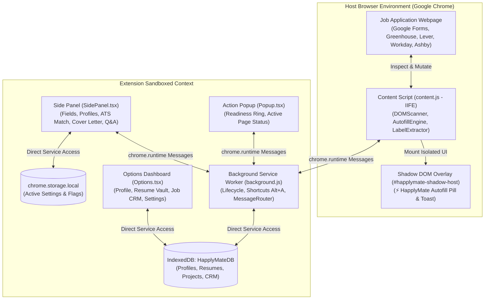

# HapplyMate – AI Career Profile Manager & Application Copilot

[](https://developer.chrome.com/docs/extensions/mv3/intro/)
[](https://www.typescriptlang.org/)
[](https://react.dev/)
[](https://vitejs.dev/)
[](https://vitest.dev/)
[](https://github.com/amanshukla2004/HapplyMate)
[](https://localfirstweb.dev/)

> **HapplyMate** is an intelligent, local-first Chrome extension engineered to streamline technical job applications. It eliminates repetitive manual data entry across modern ATS platforms (Greenhouse, Lever, Workday, Ashby, LinkedIn Easy Apply, and Google Forms) while enforcing strict user agency, zero telemetry, and a premium glassmorphic user experience.

---

## 📑 Table of Contents

- [Architectural Principles](#-architectural-principles)
- [System Architecture](#-system-architecture)
- [Key Features](#-key-features)
- [Design System & UI Architecture](#-design-system--ui-architecture)
- [Screen-by-Screen Feature Tour](#-screen-by-screen-feature-tour)
- [DOM Engine & Matching Pipeline](#-dom-engine--matching-pipeline)
- [Portal Adapters](#-portal-adapters)
- [Storage Architecture](#-storage-architecture)
- [AI Copilot Engine](#-ai-copilot-engine)
- [Manual QA & Testing Workflows](#-manual-qa--testing-workflows)
- [Getting Started & Installation](#-getting-started--installation)
- [Test Suite & Quality Verification](#-test-suite--quality-verification)
- [Directory Structure](#-directory-structure)
- [Brand & Identity Roadmap (#TODO)](#-brand--identity-roadmap-todo)
- [Security & Privacy Guarantees](#-security--privacy-guarantees)

---

## 🏛️ Architectural Principles

HapplyMate was designed from first principles following senior engineering best practices:

1. **Local-First & Zero-Telemetry**: All personal data, application records, projects, and binary resume PDFs reside exclusively inside the browser's sandboxed storage (**IndexedDB** and `chrome.storage.local`). No external databases, tracking pixels, or remote user accounts are required.
2. **Deterministic-First Matching**: Uses weighted multi-attribute heuristics (HTML attributes, autocomplete tokens, parent question headings, multi-ID ARIA relationships) rather than relying on non-deterministic LLMs for basic field detection.
3. **Human-in-the-Loop (Zero Auto-Submits)**: HapplyMate **never** automatically clicks "Submit" on any job application. The candidate retains full authority to review, modify, and confirm all entered data.
4. **Framework-Agnostic Reactive Mutation**: Employs native JavaScript prototype setters (`HTMLInputElement.prototype` descriptors) paired with synthetic `InputEvent`, `change`, `keydown`, `keyup`, and `blur` events to ensure reactive frameworks (React, Angular, Polymer, Closure) update internal state reliably.
5. **Zero-Syntax-Error Content Script Model**: Employs a dedicated dual-stage Vite bundling pipeline that packages `content.js` into a 100% self-contained Immediately Invoked Function Expression (IIFE), completely eliminating Chrome MV3 dynamic `import` syntax crashes.
6. **Shadow DOM Isolation**: In-page floating widgets and feedback toasts are encapsulated inside an isolated `ShadowRoot`, guaranteeing complete style containment so host site CSS never leaks in or out.
7. **Offline-First Typography & CSP Compliance**: All typography (`Bricolage Grotesque` and `DM Sans`) is bundled locally as `.woff2` font files within the extension package. No remote CDN calls are made, guaranteeing strict extension Content Security Policy (CSP) compliance and full offline availability.

---

## 🚀 Key Features

* **Zero-Cloud PDF Resume Onboarding**: Drag & drop any PDF resume in the Resume Vault; client-side decompression extracts contact info, education, work experience, and categorized skills with 1-click profile population.
* **1-Click Keyboard Shortcut (`Alt+A`)**: Instantly autofills the active job form on any supported site without opening the side panel.
* **Workday Multi-Page Form Wizard Automator**: Detects page changes across multi-step Workday portals (`pushState`, `popstate`, `hashchange`), re-scanning and highlighting next-step fields automatically.
* **Ashby ATS Portal Adapter**: First-class support for `jobs.ashbyhq.com` and Ashby embedded applications with synthetic React event dispatch.
* **Smart Job Description ATS Match & Skill Gap**: 1-click scan of the active job post, calculating keyword match score %, highlighting matched and missing skills, with a 1-click **"+ Add to Profile"** skill sync.
* **Grounded AI Cover Letter Generator**: Generates concise 3-paragraph cover letters tailored to the target company, role, candidate projects, and desired tone (Confident, Technical, Enthusiastic) with 1-click clipboard copy.
* **5-Stage Kanban CRM Pipeline**: Track job status across Saved, Applied, Interview, Offer, Rejected with platform badges (Workday, Greenhouse, Lever, Ashby, LinkedIn, Indeed), search filtering, manual logging dialog, and RFC 4180 CSV export.

---

## 📐 System Architecture

### High-Level Component & Communication Flow



---

## 🧪 Manual QA & Testing Workflows

For detailed manual testing instructions, step-by-step verification flows, and an investor demo script, see:
👉 [MANUAL_QA_WORKFLOW_TESTING_GUIDE.md](file:///c:/Users/rajsh/Desktop/ALL%20PROJECTS/PROJECTS/ApplyMate/MANUAL_QA_WORKFLOW_TESTING_GUIDE.md)

---

## 🛠️ Getting Started & Installation

### Build Extension
```bash
cd extension
npm install
npm run build
```

### Run Automated Tests
```bash
npm test
```
All 8 test suites and 46 automated unit tests should pass with 100% success.

### Package for Chrome Web Store
```bash
npm run package
```
Generates `happlymate.zip` ready for store submission.

---

## 🎨 Brand & Identity Roadmap (#TODO)

* **#TODO: [Brand & Identity] Custom HapplyMate Logo Design**:
  - Finalize official custom vector logo and render high-resolution PNGs:
    - `16x16`: Browser tab and extension tray favicon
    - `32x32`: Chrome extension manager
    - `48x48`: Extensions menu icon
    - `128x128`: Chrome Web Store official store icon
  - Motif: Modern, cheerful, optimistic 'H' / 'A' monogram with upward ascending launch trajectory and lilac/indigo gradient (`#8B74F0` -> `#6366F1`).

---

## 🛡️ Security & Privacy Guarantees

* **Zero External Telemetry**: HapplyMate transmits zero background telemetry or keystrokes.
* **Sandboxed Storage**: Resumes and profiles are isolated inside browser-enforced origin storage.
* **Minimal Privileges**: Manifest permissions are strictly limited to `activeTab`, `storage`, `sidePanel`, `scripting`, and `tabs`.
* **Human-in-the-Loop**: Never auto-submits any application.

---

## 📄 License

Distributed under the MIT License.
