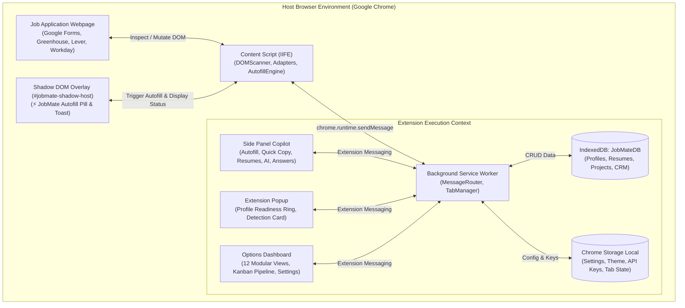
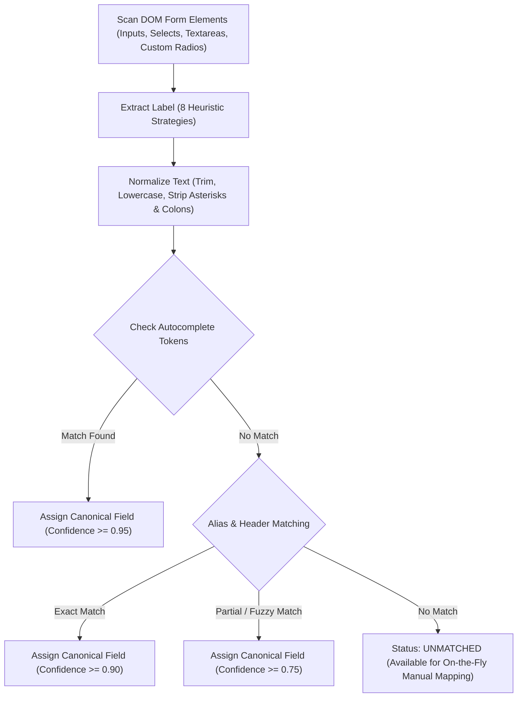

# ApplyMate – Personal Career Profile Manager & Application Copilot

[](https://developer.chrome.com/docs/extensions/mv3/intro/)
[](https://www.typescriptlang.org/)
[](https://react.dev/)
[](https://vitejs.dev/)
[](https://vitest.dev/)
[](https://github.com/amanshukla2004/ApplyMate)
[](https://localfirstweb.dev/)

> **ApplyMate** is an intelligent, local-first Chrome extension engineered to streamline technical job applications. It eliminates repetitive manual data entry across modern ATS platforms (Greenhouse, Lever, Workday, LinkedIn Easy Apply, and Google Forms) while enforcing strict user agency, zero telemetry, and a premium glassmorphic user experience.

---

## 📑 Table of Contents

- [Architectural Principles](#-architectural-principles)
- [System Architecture](#-system-architecture)
- [Design System & UI Architecture](#-design-system--ui-architecture)
- [Screen-by-Screen Feature Tour](#-screen-by-screen-feature-tour)
  - [1. Options Dashboard (`options.html`)](#1-options-dashboard-optionshtml)
  - [2. Side Panel Copilot (`sidepanel.html`)](#2-side-panel-copilot-sidepanelhtml)
  - [3. Extension Popup Launchpad (`popup.html`)](#3-extension-popup-launchpad-popuphtml)
  - [4. In-Page Overlay Layer (`content.ts`)](#4-in-page-overlay-layer-contentts)
- [DOM Engine & Matching Pipeline](#-dom-engine--matching-pipeline)
- [Portal Adapters](#-portal-adapters)
- [Storage Architecture](#-storage-architecture)
- [AI Copilot Engine](#-ai-copilot-engine)
- [Engineering Deep Dives](#-engineering-deep-dives)
- [Getting Started & Installation](#-getting-started--installation)
- [Test Suite & Quality Verification](#-test-suite--quality-verification)
- [Directory Structure](#-directory-structure)
- [Future Cloud Backend Roadmap](#-future-cloud-backend-roadmap)
- [Security & Privacy Guarantees](#-security--privacy-guarantees)

---

## 🏛️ Architectural Principles

JobMate was designed from first principles following senior engineering best practices:

1. **Local-First & Zero-Telemetry**: All personal data, application records, projects, and binary resume PDFs reside exclusively inside the browser's sandboxed storage (**IndexedDB** and `chrome.storage.local`). No external databases, tracking pixels, or remote user accounts are required.
2. **Deterministic-First Matching**: Uses weighted multi-attribute heuristics (HTML attributes, autocomplete tokens, parent question headings, multi-ID ARIA relationships) rather than relying on non-deterministic LLMs for basic field detection.
3. **Human-in-the-Loop (Zero Auto-Submits)**: JobMate **never** automatically clicks "Submit" on any job application. The candidate retains full authority to review, modify, and confirm all entered data.
4. **Framework-Agnostic Reactive Mutation**: Employs native JavaScript prototype setters (`HTMLInputElement.prototype` descriptors) paired with synthetic `InputEvent`, `change`, `keydown`, `keyup`, and `blur` events to ensure reactive frameworks (React, Angular, Polymer, Closure) update internal state reliably.
5. **Zero-Syntax-Error Content Script Model**: Employs a dedicated dual-stage Vite bundling pipeline that packages `content.js` into a 100% self-contained Immediately Invoked Function Expression (IIFE), completely eliminating Chrome MV3 dynamic `import` syntax crashes.
6. **Shadow DOM Isolation**: In-page floating widgets and feedback toasts are encapsulated inside an isolated `ShadowRoot`, guaranteeing complete style containment so host site CSS never leaks in or out.
7. **Offline-First Typography & CSP Compliance**: All typography (`Bricolage Grotesque` and `DM Sans`) is bundled locally as `.woff2` font files within the extension package. No remote CDN calls (such as Google Fonts) are made, guaranteeing strict extension Content Security Policy (CSP) compliance and full offline availability.

---

## 📐 System Architecture

### High-Level Component & Communication Flow



---

## 🎨 Design System & UI Architecture

JobMate features a bespoke glassmorphic design system built purely with modern CSS variables, semantic HTML5, and native browser capabilities—maintaining a featherweight bundle size without heavy UI frameworks.

### Design Tokens & Visual Hierarchy

| Token Group | Light Mode | Dark Mode (`data-theme="dark"`) | Calm Mode (`data-calm="on"`) |
| :--- | :--- | :--- | :--- |
| **Base Surface** | Cream `#FFF3E8` | Deep Obsidian `#1A1626` | Solid `#FFFBF6` / `#241F36` |
| **Ink (Text)** | Deep Violet `#2B2340` | Crisp Lilac `#F4F1FA` | System standard |
| **Muted** | `#5E5675` | `#B7B0C9` | High contrast |
| **Accent** | Lilac `#8B74F0` | Lilac `#8B74F0` | Solid Lilac `#8B74F0` |
| **Glass Backdrop** | `rgba(255, 255, 255, 0.6)` | `rgba(255, 255, 255, 0.08)` | Solid opaque surface |
| **Blur Effect** | `blur(26px) saturate(1.7)` | `blur(26px) saturate(1.7)` | `none` (zero blur) |
| **Blobs Opacity** | `1.0` | `0.35` | Background hidden |

### Semantic Status Indicator Pills
Status pills always convey meaning through explicit text labels paired with calibrated contrast pairs:
* **Matched (`.pill.m`)**: `#D5F5E6` background, `#17684A` text (*Dark: `#16382C` / `#8FE3BD`*)
* **Review (`.pill.r`)**: `#FFE9A8` background, `#6B4A00` text (*Dark: `#4A3A10` / `#FFD76A`*)
* **AI Draft (`.pill.a`)**: `#E9E2FF` background, `#4B3A9A` text (*Dark: `#322A5C` / `#CDBFFF`*)
* **Unknown (`.pill.u`)**: `#FFE3DA` background, `#9A3E27` text (*Dark: `#4A2419` / `#FFB3A0`*)
* **Info (`.pill.i`)**: `#DDF0FF` background, `#1D5E8F` text (*Dark: `#16384F` / `#9ED4FF`*)

### Accessibility & Motion
* **Calm Mode**: Toggled via header or extension settings. Strips all backdrop blurs and renders solid, high-legibility surfaces.
* **Prefers-Reduced-Transparency**: Automatically activates calm mode surfaces when requested by system accessibility settings.
* **Prefers-Reduced-Motion**: Disables SVG progress ring transitions, checkmark drawing animations, and card hover translations.

---

## 🖥️ Screen-by-Screen Feature Tour

### 1. Options Dashboard (`options.html`)
The command center for career profile management, architected into 12 modular sub-views under `src/options/views/`:

* **Navigation Sidebar**: Sticky 240px glass sidebar with grouped sections: *Overview*, *Profile* (Personal, Address, Links, Preferences), *Career* (Education, Experience, Skills, Projects), *Documents* (Resume Vault, Answer Bank), *Track* (Pipeline), and *Settings & Data* pinned at the bottom.
* **Overview View**:
  * Dynamic SVG circular progress ring (`Ring`) calculating real-time profile completeness (0–100%).
  * Three intelligent next-step deep-links with status badges (*"Add 5 more skills"*, *"Upload a resume"*, *"Personal details"*).
  * 4 stat cards with real counts: **Saved**, **Applied**, **Interview**, and **Offer**.
* **Personal Details**: First and last name, email address, phone with country-code select (`+91`, `+1`, `+44`, `+61`, `+49`, etc.), date of birth, gender, and US EEO Race/Ethnicity field.
* **Address Details**: Street address lines 1 & 2, city, state (with auto-suggest datalist), postal code, and country datalist.
* **Professional Links**: LinkedIn, GitHub, and portfolio URLs with live regex validation (`https://...`) and contextual hints.
* **Employment Preferences**: Notice period input with quick-pick chips (`Immediate`, `15 Days`, `30 Days`, `60 Days`, `90 Days`), current and expected compensation, selectable work model pills (*Flexible*, *Remote*, *Hybrid*, *On-site*), relocation Yes/No pills, and work authorization selector.
* **Education, Experience & Projects**: 2-column card grids displaying credentials, tags, and dates. Includes native `<dialog>` modals with auto-focus and validation for Add/Edit flows.
* **Technical Skills**: Category-colored tags with remove buttons, plus dashed suggestion chips (`+ Next.js`, `+ Docker`, `+ PostgreSQL`) across 7 categories.
* **Resume Vault**: Active resume selection, file size/upload metadata, 1-click downloads, and a dashed PDF drop zone with file picker.
* **Answer Bank**: Category-filtered question search (`Behavioral`, `Technical`, `Projects`, `Salary`, `Availability`) with 1-click clipboard copy buttons that provide instant visual confirmation.
* **Pipeline Kanban Board**:
  * Interactive 5-column board (**Saved**, **Applied**, **Interview**, **Offer**, **Rejected**).
  * **Native HTML5 Drag-and-Drop**: Dragging tilts the card 2° with dynamic drop shadow; target columns highlight with dashed accent borders.
  * Keyboard-accessible status dropdown on every card.
  * Segmented view toggle switching between **Kanban Board** and **Table View**.
* **Settings & Portability**: AI Copilot toggle (`role="switch"`), provider selector (Groq / Gemini / Custom), masked API key with validation badge, full JSON backup export/import, and a 2-step destructive wipe requiring typing `DELETE`.
* **Sticky Save Bar (`SaveBar`)**: A glass pill pinned to the bottom of the viewport that slides in only when forms have unsaved edits, featuring instant Discard and Save Changes actions.

---

### 2. Side Panel Copilot (`sidepanel.html`)
The candidate's co-pilot while actively viewing and submitting applications:

* **Header**: 32px lilac rounded-square logo with lightning bolt icon, ATS portal detection pill (`Google Forms`, `Greenhouse`, `Lever`, `Workday`, `LinkedIn`), and settings shortcut.
* **5 Dedicated Tabs**:
  1. **Autofill Tab**:
     * Summary badges displaying counts: *Found*, *Matched*, *Review*, and *Unknown*.
     * **Interactive Choice Questions**: Radio and checkbox options rendered as selectable pills with min-44px touch targets.
     * **`✨ AI Draft` Integration**: Detects open-ended questions and drafts customized responses grounded in candidate projects.
     * **Hover/Focus Highlighting**: Hovering or focusing any field card sends a message to the content script, pulsing a 2px lilac outline around the corresponding webpage input.
     * **Checkmark Draw-In Animation**: Successful field fills trigger a mint checkmark SVG stroke animation.
     * **Footer Controls**: Primary *"Fill Selected (n)"* and secondary *"Fill All Matched"* buttons.
  2. **Quick Copy Tab**:
     * Built specifically for edge-case portals or unparseable custom forms.
     * Instant 1-click copy cards for Full Name, Email, Phone, Social URLs, Address, Current Role, Degree, Notice Period, and Skills with live search.
  3. **Resume Tab**:
     * Quick access to active resume files with filename copy and download shortcuts.
  4. **AI Assistant Tab**:
     * Ad-hoc STAR question generator for behavioral questions.
  5. **Answers Tab**:
     * Searchable repository of saved application answers for manual pasting.
* **Connection Resilience**: Automatically handles disconnected tabs with 1-click *"Retry Scan"* and *"Use Quick Copy"* fallback prompts.

---

### 3. Extension Popup Launchpad (`popup.html`)
* 320px glass container with an 84px circular readiness ring (`Ring`).
* Next suggested profile step based on incomplete profile sections.
* **"On this page" Detection Card**: Identifies application page titles and detected fillable field counts.
* Direct action buttons to launch the **Side Panel** or open the **Options Dashboard**.

---

### 4. In-Page Overlay Layer (`content.ts`)
* **Shadow DOM Encapsulation**: Injected inside `#jobmate-shadow-host` with an open shadow root, preventing website CSS conflicts.
* **Floating `⚡ JobMate Autofill` Button**: 44px ink pill with white lightning icon, positioned 20px from the bottom-right corner.
* **Aria-Live Status Toast**: Mint pill notification (`role="status"`, `aria-live="polite"`) displaying filled field counts. Errors display coral styling with an inline *"Retry"* button.
* **Input Highlighting**: Filled webpage inputs receive a 2-second fading lilac border (`#8B74F0`) for immediate candidate confirmation.
* **Automatic Application Logging**: Captures form submission events to automatically record company names and job titles into the CRM tracker.

---

## 🔍 DOM Engine & Matching Pipeline



### Label Extraction Strategies
1. `aria-label` attribute inspect.
2. `aria-labelledby` multi-ID reference traversal (handles space-separated IDs like `#i1 #i4` in Google Forms).
3. Question card container queries (`.geS5n`, `[role="listitem"]`, `.Qr7Oae`, `[data-item-id]`) and heading extraction (`.M7eMe`, `.FwR7Pc`, `[role="heading"]`).
4. Explicit `<label for="...">` DOM element queries.
5. Enclosing `<label>` container cloning with input stripping.
6. `placeholder` fallback.
7. Preceding sibling labels or text spans.
8. Parent container header traversal.

---

## 🔌 Portal Adapters

| Portal | Adapter Class | Specialized Strategies |
| :--- | :--- | :--- |
| **Google Forms** | `GoogleFormsAdapter` | Container header parsing (`.M7eMe`, `.geS5n`), multi-ID ARIA mapping, custom radio group detection (`role="radio"`), `InputEvent` dispatching. |
| **Greenhouse** | `GreenhouseAdapter` | Array-notation input name mapping (`urls[LinkedIn]`, `urls[GitHub]`), resume upload wrappers. |
| **Lever** | `LeverAdapter` | Custom form structures, social link groupings, organization fields. |
| **Workday** | `WorkdayAdapter` | Automation ID selector matching (`data-automation-id="legalNameSection_firstName"`). |
| **LinkedIn** | `LinkedInAdapter` | Easy Apply multi-step modal traversal and pagination listeners. |
| **Generic Web Form** | `GenericAdapter` | Universal fallback matching standard HTML5 forms on bespoke career sites. |

---

## 💾 Storage Architecture

```text
┌────────────────────────────────────────────────────────┐
│                   JOBMATE LOCAL STORAGE                │
├──────────────────────────┬─────────────────────────────┤
│   IndexedDB (JobMateDB)  │    Chrome Storage Local     │
│   (Relational & Binary)  │    (Settings & Flags)       │
├──────────────────────────┼─────────────────────────────┤
│ • Canonical User Profile │ • App Settings (aiEnabled)  │
│ • Education History      │ • AI Provider & API Keys    │
│ • Work Experience        │ • Theme (light/dark/system) │
│ • Categorized Skills     │ • Calm Mode Toggle (on/off) │
│ • Binary PDF Resumes     │ • Active Tab Cache          │
│ • Technical Projects     │                             │
│ • Reusable Answer Bank   │                             │
│ • Application CRM Records│                             │
└──────────────────────────┴─────────────────────────────┘
```

---

## 🤖 AI Copilot Engine

* **Grounded Synthesis**: Restricts prompts strictly to facts present in candidate profile, projects, and work history.
* **Supported Providers**: User-configured API keys for **Groq (Llama 3.3 70B)** and **Google Gemini 1.5 Flash**.
* **Offline Heuristic Synthesizer**: Automatically synthesizes structured answers using local heuristic assembly when no API key is present.
* **STAR Methodology**: Automatically structures behavioral answers into **Situation**, **Task**, **Action**, and **Result**.

---

## 🔬 Engineering Deep Dives

### 1. Dual-Build Vite Pipeline for Content Script Isolation
Standard Vite builds bundle all entry points into ES modules using Rollup code-splitting. However, Chrome Manifest V3 content scripts run in an isolated world as classic scripts; importing an ES module throws `Uncaught SyntaxError: Cannot use import statement outside a module`.
JobMate solves this via a dedicated secondary build file (`vite.content.config.ts`) compiling `content.ts` into a standalone Immediately Invoked Function Expression (IIFE) with inlined dependencies:
```bash
tsc && vite build && vite build --config vite.content.config.ts
```

### 2. Reactive Framework Value Setting
Assigning values via `input.value = "val"` fails in React, Vue, and Angular because framework getters/setters override native properties. JobMate bypasses this using prototype property descriptors:
```typescript
const proto = el.tagName === 'TEXTAREA' ? HTMLTextAreaElement.prototype : HTMLInputElement.prototype;
const descriptor = Object.getOwnPropertyDescriptor(proto, 'value');
if (descriptor && descriptor.set) {
  descriptor.set.call(el, value);
} else {
  (el as HTMLInputElement).value = value;
}
el.dispatchEvent(new InputEvent('input', { bubbles: true, cancelable: true, inputType: 'insertText', data: value }));
el.dispatchEvent(new Event('change', { bubbles: true, cancelable: true }));
el.dispatchEvent(new Event('blur', { bubbles: true, cancelable: true }));
```

### 3. Zero-Leak Shadow DOM Overlay
To prevent candidate host websites from breaking JobMate's in-page controls (or extension styles breaking host layouts), all in-page floating buttons and status toasts are attached to an open `ShadowRoot`:
```typescript
const host = document.createElement('div');
host.id = 'jobmate-shadow-host';
host.style.all = 'initial';
const shadow = host.attachShadow({ mode: 'open' });
```

---

## 🚀 Getting Started & Installation

### Prerequisites
* **Node.js**: `v18.0.0` or higher
* **npm**: `v9.0.0` or higher
* **Browser**: Google Chrome, Brave, Edge, or any Chromium browser supporting Manifest V3

### Installation & Build

```bash
# 1. Clone repository
git clone https://github.com/amanshukla2004/ApplyMate.git
cd ApplyMate/extension

# 2. Install dependencies
npm install

# 3. Run automated test suites
npm test

# 4. Build production extension bundles
npm run build
```

### Loading into Google Chrome (Development)
1. Open Chrome and navigate to `chrome://extensions/`.
2. Toggle on **Developer mode** in the upper-right corner.
3. Click **Load unpacked** in the top-left.
4. Select the directory:
   ```text
   ApplyMate/extension/dist
   ```
5. Pin **ApplyMate** to your Chrome toolbar.

### Packaging for Chrome Web Store (Production)
To generate a store-ready, Manifest V3 compliant `.zip` archive containing all root assets, icons, fonts, and scripts:

```bash
cd extension
npm run package
```
This automatically compiles the TypeScript bundles and outputs `applymate.zip` directly in `extension/`, ready to upload to the [Chrome Web Store Developer Dashboard](https://chrome.google.com/webstore/devconsole).

---

## 🧪 Test Suite & Quality Verification

JobMate includes 30 automated tests executed via **Vitest** and **JSDOM**:

```bash
cd extension
npm test
```

```text
 ✓ tests/FieldMatcher.test.ts (7 tests)
 ✓ tests/LabelExtractor.test.ts (6 tests)
 ✓ tests/ProfileService.test.ts (4 tests)
 ✓ tests/AnswerService.test.ts (2 tests)
 ✓ tests/AutofillEngine.test.ts (3 tests)
 ✓ tests/Adapters.test.ts (8 tests)

 Test Files  6 passed (6)
      Tests  30 passed (30)
```

---

## 📂 Directory Structure

```text
ApplyMate/
├── extension/
│   ├── public/
│   │   └── manifest.json             # Manifest V3 configuration
│   ├── src/
│   │   ├── adapters/                 # ATS & Portal adapters (Google Forms, Greenhouse, etc.)
│   │   ├── background/               # Service worker, message router, tab manager
│   │   ├── components/ui/            # Reusable UI kit (Button, Card, Pill, Ring, Modal, etc.)
│   │   ├── content/                  # DOM scanner, label extractor, autofill engine, overlay
│   │   ├── hooks/                    # Custom hooks (useTheme)
│   │   ├── options/
│   │   │   ├── views/                # 12 Modular views (Overview, Personal, Pipeline, etc.)
│   │   │   └── Options.tsx           # Options dashboard shell
│   │   ├── popup/                    # Popup component (Popup.tsx)
│   │   ├── sidepanel/                # Side panel component (SidePanel.tsx)
│   │   ├── services/                 # IndexedDB, Storage, Profile, and AI services
│   │   ├── styles/
│   │   │   ├── fonts/                # Local bundled .woff2 fonts & fonts.css
│   │   │   ├── tokens.css            # Light, dark, and calm mode tokens
│   │   │   ├── glass.css             # Glassmorphism and backdrop glow styles
│   │   │   ├── components.css        # Shared component styles
│   │   │   └── globals.css           # Global resets and CSS imports
│   │   └── types/                    # Canonical schemas and messaging types
│   ├── tests/                        # Vitest test suite
│   ├── vite.config.ts                # Main Vite build configuration
│   ├── vite.content.config.ts        # Standalone IIFE Vite build configuration
│   ├── tsconfig.json
│   └── package.json
├── test-portal/                      # Local HTML test environment for mock job applications
├── .gitignore                        # Senior developer Git ignore rules
└── README.md                         # Master documentation
```

---

## 🔮 Future Cloud Backend Roadmap

When scaling beyond local-first single-browser usage:
* **Backend Stack**: **Java 21 LTS** + **Spring Boot 3.3+**, Spring Security (JWT / OAuth2), Spring Data JPA.
* **Database**: **PostgreSQL 16** with Flyway migrations and `pgvector` for semantic answer retrieval.
* **Blob Storage**: **AWS S3** / MinIO for encrypted resume storage with pre-signed download URLs.
* **Delta Sync**: Bidirectional sync between IndexedDB and cloud PostgreSQL.

---

## 🛡️ Security & Privacy Guarantees

* **Zero External Telemetry**: JobMate transmits zero background telemetry or keystrokes.
* **Sandboxed Storage**: Resumes and profiles are isolated inside browser-enforced origin storage.
* **Minimal Privileges**: Manifest permissions are strictly limited to `activeTab`, `storage`, `sidePanel`, `scripting`, and `tabs`.

---

## 📄 License

Distributed under the MIT License. See `LICENSE` for more information.
