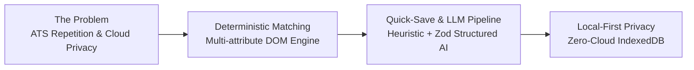

# HapplyMate – Interviewer Guide, Feature Pitch & Run Instructions

> **Project Name:** HapplyMate (formerly JobMate / ApplyMate)  
> **Tech Stack:** React 18, TypeScript 5.7, Manifest V3 (Chrome Extension), Vite 6, Vitest, Tailwind CSS, IndexedDB, Zod, Groq / Google Gemini APIs.  
> **Architecture:** 100% Local-First, Zero-Telemetry, Deterministic-First Matching Engine.

---

## 🚀 1. How to Run & Test This Project (Zero to Running)

Follow these exact steps to compile the extension, load it into Google Chrome, and test it locally.

### Prerequisites
- **Node.js:** v18.0.0 or higher (`node -v`)
- **Package Manager:** `npm` (`npm -v`)
- **Browser:** Google Chrome, Brave, Arc, or Microsoft Edge (Chromium Manifest V3 compatible)

---

### Step 1: Install Dependencies & Build
Open your terminal in the project root:

```bash
# Navigate to the extension folder
cd extension

# Install dependencies
npm install

# Build the production bundle (builds popup, sidepanel, options, background, and content script)
npm run build
```

This generates the self-contained `extension/dist/` directory containing:
- `manifest.json`
- `background.js` (Service Worker)
- `content.js` (Self-contained IIFE content script)
- `popup.html`, `sidepanel.html`, `options.html`
- Local bundled assets and fonts (`.woff2`)

---

### Step 2: Load the Extension into Chrome
1. Open Google Chrome and navigate to:
   ```text
   chrome://extensions
   ```
2. In the top-right corner, turn **ON** the **"Developer mode"** toggle switch.
3. In the top-left corner, click the **"Load unpacked"** button.
4. Select the directory:
   ```text
   <your-path>/ApplyMate/extension/dist
   ```
5. Click the puzzle icon (Extensions) in your Chrome toolbar and **pin "HapplyMate"** for quick access.

---

### Step 3: Test on the Local Mock Portal
A full mock job application portal is included in the repository to demo and test autofill without needing live external accounts:

1. Open a new Chrome tab and press `Ctrl + O` (or `Cmd + O` on macOS).
2. Select the file:
   ```text
   <your-path>/ApplyMate/test-portal/index.html
   ```
   *(Alternatively, run `npx serve test-portal` from the root and visit `http://localhost:3000`)*.
3. You will see a mock application with Name, Email, Phone, LinkedIn, Education, Experience, and Screener questions.
4. **Trigger Autofill:**
   - Press **`Alt + A`** on your keyboard, OR
   - Click the floating **"⚡ HapplyMate Autofill"** pill in the bottom-right corner, OR
   - Open the HapplyMate popup and click **"Autofill Form Now"**.
5. Watch the fields highlight and populate automatically with realistic change events!

---

### Step 4: Run the Automated Test Suite
The project includes **101 unit and integration tests** verifying all core services, regex extractors, ATS adapters, and security bounds:

```bash
cd extension
npm test -- --run
```

All 13 test suites will run and pass cleanly via Vitest in under 18 seconds.

---

## 🎯 2. How to Pitch Features to an Interviewer

When presenting HapplyMate to a technical interviewer, don't just say *"it fills forms."* Frame it as an **autonomous, privacy-first technical copilot solving real engineering challenges in DOM manipulation, asynchronous distributed browser lifecycles, and local-first data integrity.**

Here is the structured 4-part narrative to use:



---

### Feature 1: Deterministic-First Form Autofill Engine
* **What to tell the interviewer:**  
  *"Most AI extensions send entire webpage DOMs to an LLM. That is slow (3-5s), expensive, prone to hallucinations, and leaks user data. Instead, I designed a **deterministic-first multi-attribute scoring engine**."*
* **How it works technically:**
  - `LabelExtractor.ts` scans candidate elements using weighted heuristics: explicit `<label for="">`, parent `<label>`, aria-labelledby, placeholder, name, id, and preceding heading text.
  - Matches against canonical field aliases using cached `WeakMap` tokens for sub-millisecond execution.
  - Specialized portal adapters for **Greenhouse, Lever, Workday, Ashby, Zoho Recruit, Taleo, and Google Forms**.

### Feature 2: Framework-Agnostic Reactive DOM Mutation
* **What to tell the interviewer:**  
  *"Modern web apps built with React, Angular, or Polymer ignore standard `input.value = 'x'` assignments because they wrap inputs with synthetic state trackers. If you set `input.value` directly, the form clears itself on submit."*
* **How you solved it:**  
  - You used native property descriptors:  
    `Object.getOwnPropertyDescriptor(window.HTMLInputElement.prototype, 'value')?.set?.call(element, value)`
  - Followed by dispatching a cascade of native synthetic events: `InputEvent('input', { bubbles: true })`, `'change'`, and `'blur'`. This guarantees reactive state managers (Redux, React Hooks, Formik) recognize the input.

### Feature 3: Quick Save Job & Dual-Stage LLM Extraction
* **What to tell the interviewer:**  
  *"Job posts on LinkedIn, Twitter, or email threads often say: 'Send resume to hr@xyz.com with subject Application - Role'. Users don't want to apply immediately; they want to dump the text and act later."*
* **How you solved it:**  
  - **Instant Zero-Latency Stage:** When a user pastes text into the popup, `JobExtractorService.extractHeuristically()` runs deterministic regexes in <2ms, writing an initial record to IndexedDB immediately so the popup never freezes.
  - **Background AI Stage:** In the background service worker, Groq / Gemini is invoked with strict prompt boundaries. The response is validated at runtime using a **Zod schema** (`SavedJobExtractionSchema`).
  - **Zero-Loss Data Integrity:** The original raw text is stored untouched alongside the extracted fields. The user has a side-by-side toggle ("Extracted Data" vs "Original Raw Text") and can edit fields or re-run extraction at will.

### Feature 4: 100% Local-First, Zero-Cloud Security Architecture
* **What to tell the interviewer:**  
  *"Privacy was a non-negotiable architectural requirement. Career data includes phone numbers, home addresses, education records, and resume PDFs. I built HapplyMate with a strict Zero-Cloud boundary."*
* **How you proved it:**
  - All profile data and binary resume blobs are persisted locally in browser **IndexedDB (`JobMateDB`)** and `chrome.storage.local`.
  - No remote user tracking, no backend database storing applicant credentials.
  - LLM API calls are made directly from the user's browser client to the model provider using the user's personal API key.

### Feature 5: In-Page Shadow DOM Isolation & Keyboard Automation
* **What to tell the interviewer:**  
  *"Injected extension elements often suffer from CSS bleed—either host styles break the extension button, or the extension CSS alters the client's page."*
* **How you solved it:**  
  - Encapsulated the in-page floating pill and notification toasts inside a closed **Shadow DOM (`#happlymate-shadow-host`)**.
  - Registered a global Chrome shortcut (`Alt + A`) managed via `chrome.commands` in the background service worker for instant 1-click execution.

### Feature 6: Application CRM & ATS Keyword Match
* **What to tell the interviewer:**  
  *"Applying is only half the battle. Candidates need to track applications and tailor their resume."*
* **How you solved it:**  
  - DOM job description parser scrapes requirements, calculates skill match percentage against candidate profile skills, and provides a 1-click **"+ Add to Profile"** sync.
  - Built a 5-stage Kanban board (Saved $\rightarrow$ Applied $\rightarrow$ Interview $\rightarrow$ Offer $\rightarrow$ Rejected) with RFC 4180 CSV export.

---

## 🔄 3. Core Workflows (Walkthrough for Interviews)

### Workflow A: The 1-Click Autofill Pipeline
```text
[User presses Alt+A or clicks Pill]
        │
        ▼
[content.js: domScanner.scanForm()]
        │
        ▼
[labelExtractor.extractLabel()] (ARIA, <label>, Placeholder, Proximity)
        │
        ▼
[fieldMatcher.matchField()] (Canonical normalization, alias lookup)
        │
        ▼
[autofillEngine.fillField()] (Native prototype setter + synthetic dispatch)
        │
        ▼
[Shadow DOM Toast displays count: "14 fields filled! Review before submitting"]
```

### Workflow B: The Quick Save Job Pipeline
```text
[User pastes unstructured job text into Popup]
        │
        ▼
[Optimistic Heuristic Extraction (<2ms)]
        │
        ▼
[Persist initial record in IndexedDB (status: 'to-apply', extractionStatus: 'pending')]
        │
        ▼
[Background Service Worker triggers LLM (Groq / Gemini)]
        │
        ▼
[Zod Schema Validation & Auto-Retry Loop]
        │
        ▼
[Update record in IndexedDB (status: 'to-apply' or 'needs-review')]
        │
        ▼
[Detail Modal renders dual view: Extracted fields + Raw original text]
```

### Workflow C: The Self-Healing MV3 Service Worker Recovery
```text
[Browser terminates idle Service Worker mid-extraction]
        │
        ▼
[User restarts browser or triggers extension event]
        │
        ▼
[serviceWorker.ts starts up]
        │
        ▼
[Query IndexedDB for jobs with extractionStatus === 'pending']
        │
        ▼
[Re-execute extraction or gracefully fall back to heuristic extraction]
        │
        ▼
[Zero stranded tasks / zero infinite spinners]
```

---

## ❓ 4. Things an Interviewer Can Ask (and How to Answer)

Here is a curated list of tough technical, architectural, and behavioral questions an interviewer might throw at you regarding HapplyMate, along with the ideal senior-engineer responses:

---

### Technical & DOM Questions

#### Q1: "Why can't you just use `element.value = 'John'` when filling form inputs?"
* **Your Answer:**  
  *"Modern Single Page Applications (SPAs) built with React, Angular, or Vue use synthetic event systems and internal property value tracking (`_valueTracker` in React). When you assign `element.value = 'x'` directly, you modify the DOM property without triggering the component's internal setter. As soon as the user clicks 'Submit' or interacts with the form, React checks its internal state, sees an empty string, and wipes the field.*  
  *To solve this, I used native prototype descriptors:*  
  ```javascript
  const nativeInputValueSetter = Object.getOwnPropertyDescriptor(
    window.HTMLInputElement.prototype, 'value'
  ).set;
  nativeInputValueSetter.call(element, value);
  element.dispatchEvent(new Event('input', { bubbles: true }));
  element.dispatchEvent(new Event('change', { bubbles: true }));
  ```  
  *This forces the reactive framework to sync its internal state."*

#### Q2: "How do you handle multi-page job application wizards (e.g., Workday) where the page doesn't reload?"
* **Your Answer:**  
  *"Workday and modern ATS platforms use client-side routing. Since the page doesn't reload, traditional `DOMContentLoaded` events don't fire. I implemented a `MutationObserver` with a **300ms debounce window** to observe DOM changes without CPU thrashing, combined with interception of `pushState`, `replaceState`, and `popstate` events. When a user clicks 'Next Page', the scanner automatically detects new input containers and highlights un-filled fields."*

#### Q3: "How do you prevent extension styling from breaking the webpage or vice-versa?"
* **Your Answer:**  
  *"I use **Shadow DOM** (`element.attachShadow({ mode: 'open' })`). The extension's floating autofill pill and status toasts are attached inside the shadow root. Host page CSS rules cannot penetrate into the shadow root, and our extension styles cannot leak out and corrupt the host page layout."*

---

### Manifest V3 & Browser Architecture Questions

#### Q4: "What is the biggest challenge of Chrome Manifest V3, and how did you solve it?"
* **Your Answer:**  
  *"The transition from persistent background pages to **ephemeral Service Workers**. In MV3, the browser can suspend and terminate the service worker after 30 seconds of inactivity or under memory pressure. If a service worker is suspended while waiting for an external LLM API call, fire-and-forget promises are lost, leaving database records stuck in `pending` indefinitely.*  
  *I solved this with a **Self-Healing Startup Reconciliation Pattern**: on service worker initialization, the background script queries IndexedDB for any records stranded with `extractionStatus: 'pending'` and rehydrates or resolves them safely."*

#### Q5: "Why did you build content scripts as an IIFE rather than ES Modules?"
* **Your Answer:**  
  *"Chrome MV3 content scripts run in isolated worlds and have strict constraints regarding dynamic ES Module imports (`import(...)`). Bundling content scripts as dynamic chunks frequently causes runtime syntax errors. I configured a custom dual-stage Rollup/Vite build pipeline (`vite.content.config.ts`) that bundles `content.ts` into a single, zero-dependency Immediately Invoked Function Expression (IIFE), guaranteeing 100% syntax compliance across all target sites."*

---

### Security, Privacy & AI Questions

#### Q6: "How do you protect users against Stored XSS and malicious job descriptions?"
* **Your Answer:**  
  *"Raw job text is untrusted user input. If a job post contains `javascript:alert(1)` in a form link or malicious HTML, opening or rendering it directly could compromise the extension. I implemented three layers of defense:*  
  *1. **Zero `dangerouslySetInnerHTML`:** All extracted text is rendered through React's native JSX escaping.*  
  *2. **Strict URL Scheme Validation:** A custom utility `safeOpenExternalUrl` strictly whitelists `http:` and `https:`, blocking `javascript:`, `data:`, or `blob:` protocol smuggling.*  
  *3. **Prompt Injection Boundary:** LLM prompts enclose raw text in triple quotes with explicit system directives to treat the content purely as passive data, ignoring any embedded instructions."*

#### Q7: "Why didn't you build a centralized cloud backend with user accounts?"
* **Your Answer:**  
  *"Job application data is highly sensitive PII: resumes, phone numbers, addresses, employment history, and diversity questionnaires. Storing that in a centralized database makes the application a target for data breaches and introduces GDPR/CCPA regulatory burdens.*  
  *By adopting a **Local-First Architecture** with IndexedDB, user data never leaves their local device. It also makes the extension blazingly fast with zero server latency and zero hosting costs."*

#### Q8: "How do you prevent regex catastrophic backtracking (ReDoS) if someone pastes a massive 50MB file?"
* **Your Answer:**  
  *"Before passing raw user input to regular expressions or string parsers, we pass it through `boundTextInput(rawText, 50000)`, bounding the processing context to 50,000 characters while preserving the full untouched raw text in IndexedDB. All regular expressions use atomic tokens without nested greedy quantifiers `(a+)+`."*

---

### Product & Design Decisions

#### Q9: "Why doesn't HapplyMate automatically submit the application for the user?"
* **Your Answer:**  
  *"Human-in-the-loop is a core product principle. Automated auto-submits frequently fail on tricky screener questions ('Are you willing to relocate to Antarctica?') or legal attestations, which can disqualify a candidate. HapplyMate acts as a **copilot, not an autopilot**. It does the heavy lifting of filling 90% of the repetitive fields, but leaves the final review and submission click in the hands of the human candidate."*

#### Q10: "If you had 3 more months to work on this, what would you build next?"
* **Your Answer:**  
  *"Three high-impact roadmap items:*  
  *1. **CRDT / Cloud-Sync Layer:** Use an end-to-end encrypted local-first sync protocol (like Yjs or ElectricSQL) so candidates can seamlessly sync profiles across their laptop and desktop without compromising privacy.*  
  *2. **Email Application Copilot:** Direct Gmail/Outlook integration that generates a tailored email draft with the attached resume whenever an 'email-type' saved job is detected.*  
  *3. **Dynamic Portal Auto-Learning:** A community-contributed crowdsourced field mapping registry where users can opt-in to export anonymous DOM selectors for newly emerging ATS portals."*

---

## 📊 5. Summary Cheat Sheet for Interview Day

| Feature | Technical Architecture | Pitch Keyword |
| :--- | :--- | :--- |
| **Autofill Engine** | Multi-attribute label heuristics + native prototype setters | *Deterministic-First, Reactive State Sync* |
| **Quick Save Job** | Dual-stage: <2ms regex + background Zod-validated LLM | *Non-blocking UX, Zero-loss storage* |
| **Persistence** | Sandboxed IndexedDB (`JobMateDB`) + `chrome.storage.local` | *Local-First, Zero-Telemetry, Privacy-First* |
| **UI Isolation** | Open/Closed Shadow DOM (`#happlymate-shadow-host`) | *Zero CSS Bleed, Encapsulated Injection* |
| **MV3 Lifecycle** | Background service worker with startup reconciliation | *Self-Healing, Fault-Tolerant Rehydration* |
| **ATS Compatibility** | 7 specialized adapters (Greenhouse, Lever, Workday, Ashby...) | *Platform Resilience, Deep Coverage* |
| **Quality Bar** | 101 automated Vitest tests, 0 TypeScript errors | *Production-Ready, Rigorously Tested* |
